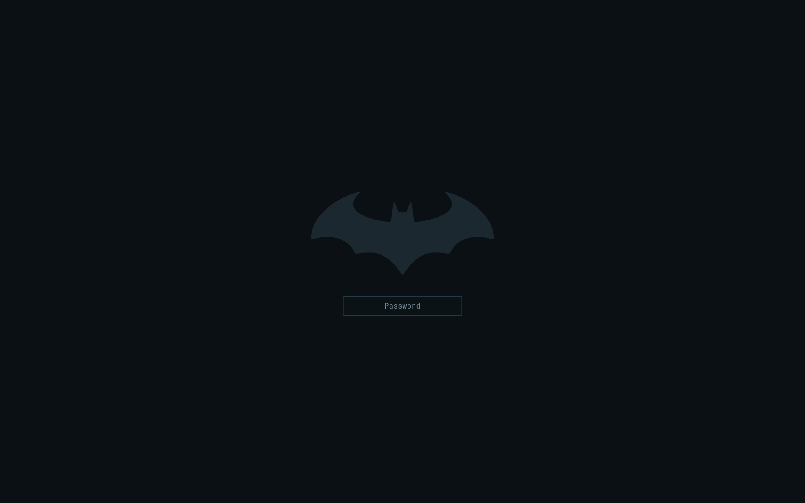

# Dark Knight

A Batman theme for [Omarchy](https://omarchy.org).


Dark blue-grey with a single accent colour. The palette is generated by a
script that checks contrast, so comments and dim text stay readable.

## Previews

| Variation | Wallpaper | Boot and disk-unlock screen |
|---|---|---|
| Gotham |  |  |
| Cape |  |  |

Gotham uses a layered Gothic and Art Deco skyline with a Bat-Signal and
sparse window strips. Cape uses only the bat emblem centred on a plain dark
background. Both use solid blue-grey vector shapes on `#0A1014`.

The artwork is fully vector, with no embedded photographs, raster layers,
gradients or textures. Editable SVGs are in [assets/artwork](assets/artwork/).
Desktop PNGs are exported at 5120x3200; the SVGs scale to any resolution.
Splash assets have transparent 1320x480 canvases. The compositions are defined
in `src/artwork.py` and `src/scenes.py`; regeneration replaces the SVG exports.
Boot uses a steel-blue bat emblem; login uses the wallpaper emblem colour
at 60% opacity and a blue-grey password border. Both centre password dots
and hide the lock icon.

The composition and production research is in
[the wallpaper brief](docs/WALLPAPER-BRIEF.md).

## Phone and tablet wallpapers

Both designs are available for iPhone, Android and iPad, including portrait
and landscape iPad layouts. The compositions leave room for the lock-screen
clock. [Browse the downloads](wallpapers/README.md) or
[download all eight PNGs](wallpapers/dark-knight-mobile.zip).

## Install

```sh
git clone https://github.com/itsgg/omarchy-dark-knight-theme.git ~/.local/share/dark-knight-theme
bash ~/.local/share/dark-knight-theme/install.sh
```

The installer applies the full theme, including Neovim syntax colours and
indent guides. It links this working copy into Omarchy and preserves any
previous install in `~/.local/state/dark-knight/backups/`. Keep the checkout
in place. Running the installer again is safe.

Switch back to it later with `omarchy theme set "Dark Knight"`.

Optional:

```sh
# GTK apps and the file chooser follow the theme
omarchy hook install theme-set ~/.config/omarchy/themes/dark-knight/hooks/gtk-follow-theme

# Boot and disk-unlock screen (asks for your password, rebuilds the initramfs)
bash ~/.config/omarchy/themes/dark-knight/src/install-splash.sh gotham
```

Updates, the standard Omarchy install, and removal are in
[docs/INSTALL.md](docs/INSTALL.md).

## Choose a variation

If the theme was already installed before these files were added, refresh
Omarchy's staged copy so both appear in the wallpaper switcher:

```sh
omarchy theme refresh
```

After installing or refreshing, apply the Gotham wallpaper with:

```sh
omarchy theme bg set ~/.local/state/omarchy/current/theme/backgrounds/1-gotham.png
```

Or apply the Cape wallpaper with:

```sh
omarchy theme bg set ~/.local/state/omarchy/current/theme/backgrounds/2-cape.png
```

Use `omarchy theme bg next` to cycle between them. Applying the current theme
again can advance the wallpaper; `omarchy theme refresh` preserves your selection.

The boot splash is selected separately. Both variations share the simple bat
emblem. These commands show a password dialog and rebuild the initramfs.
For the Gotham splash:

```sh
bash ~/.config/omarchy/themes/dark-knight/src/install-splash.sh gotham
```

For the Cape splash:

```sh
bash ~/.config/omarchy/themes/dark-knight/src/install-splash.sh cape
```

The installer uses the theme's colours and creates a separate Plymouth theme
with centred password dots and a hidden lock icon. Changing the desktop
wallpaper does not change the boot splash.

Install the matching SDDM login screen separately:

```sh
bash ~/.config/omarchy/themes/dark-knight/src/install-login.sh
```

This installs a dedicated theme under `/usr/local/share/sddm/themes` and a
small SDDM theme override. It does not restart your session.
Autologin may bypass the greeter; the installer leaves autologin unchanged.



Desktop lock follows the current wallpaper and keeps Omarchy's authentication
controls. [View Gotham](preview-lock-gotham.png) or [Cape](preview-lock-cape.png).

## Palette

| Key | Hex | Use |
|---|---|---|
| `background` | `#0A1014` | ground |
| `lighter_background` | `#162128` | raised surfaces |
| `line` | `#283943` | rules, guides, inactive border |
| `muted` | `#758A96` | comments, line numbers |
| `foreground` | `#CCCFD1` | text |
| `accent` | `#99C1DC` | focus, selection, links |
| `active_border` | `#739BB5` | focused window |
| `red` | `#BF878C` | |
| `orange` | `#B88D75` | |
| `yellow` | `#A1966D` | |
| `green` | `#7B9F7E` | |
| `cyan` | `#5BA1A3` | |
| `blue` | `#7F97BE` | |
| `magenta` | `#B389A7` | |

## What is included

Everything Omarchy generates from `colors.toml` (terminals, Hyprland, the
shell, Chromium, VS Code, Obsidian), plus:

| File | |
|---|---|
| `backgrounds/` | Gotham and Cape wallpapers |
| `shell.*.toml` | bar, launcher, menu, lock card, control states |
| `neovim.lua` | quiet indent guides, syntax colour kept for data |
| `gtk.css`, `gtk3.css` | libadwaita and the GTK3 file chooser |
| `btop.theme` | monochrome meters |
| `unlock.png`, `unlock-cape.png` | Gotham and Cape Plymouth splash assets |

## Development

```sh
python3 src/palette.py > colors.toml   # fails if a contrast floor is missed
src/render.sh                          # theme files, flat SVGs, PNGs and previews
python3 src/artwork.py                 # rerender only the two artwork pairs
python3 src/mobile.py                  # phone and tablet artwork, preview and ZIP
src/preview.sh                         # retakes preview.png
python3 -m unittest discover -s tests -v # installer checks; requires bubblewrap
```

Design notes: [docs/DESIGN.md](docs/DESIGN.md).

## License

MIT. See [LICENSE](LICENSE).
