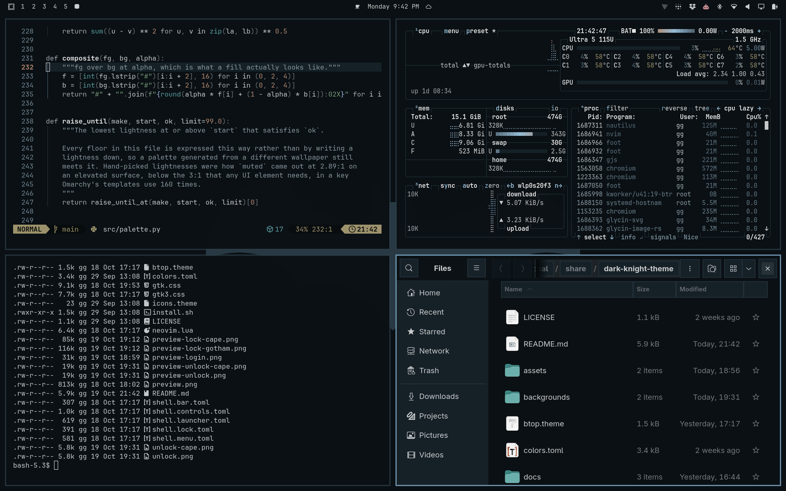
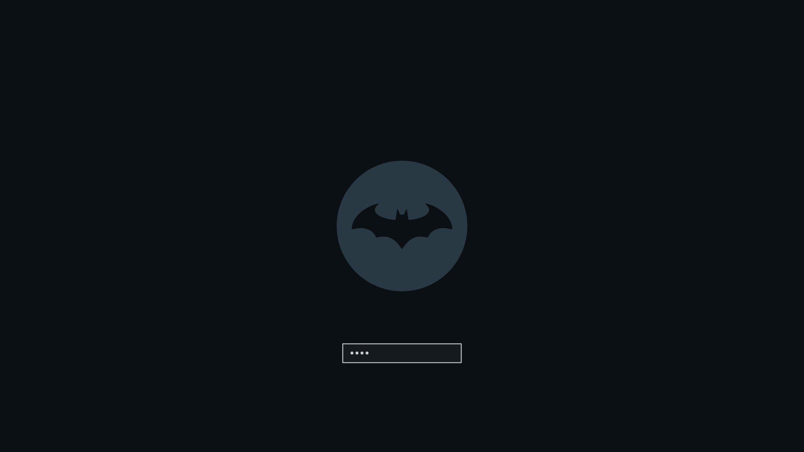
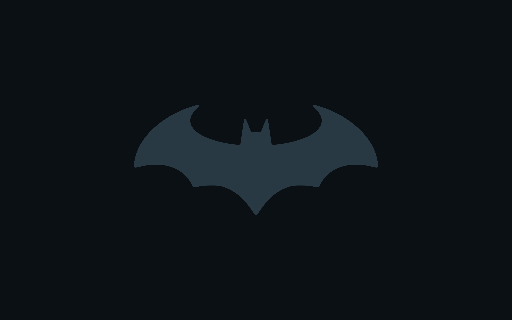
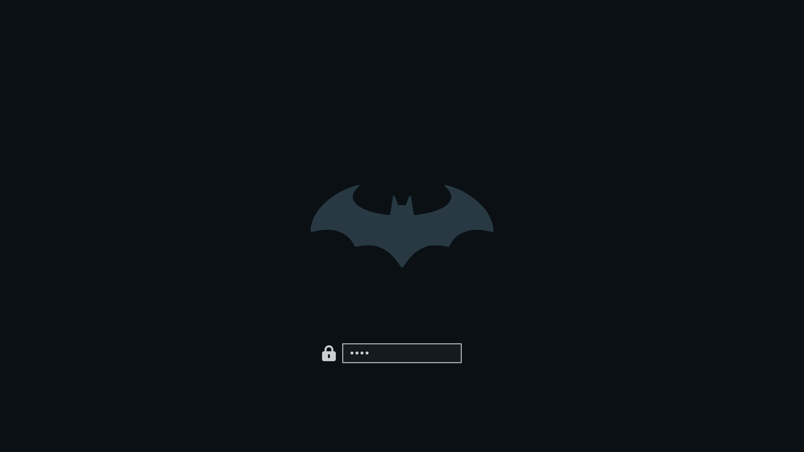

# Dark Knight

A Batman theme for [Omarchy](https://omarchy.org).



Dark blue-grey with a single accent colour. The palette is generated by a
script that checks contrast, so comments and dim text stay readable.

## Previews

| Variation | Wallpaper | Boot and disk-unlock screen |
|---|---|---|
| Gotham |  |  |
| Cape |  |  |

Gotham is a flat skyline with a Bat-Signal above it. Cape uses a large bat
silhouette and broad angular planes. Both use solid blue-grey colours on
Foot's `#0A1014` background, with no gradients, textures or 3D effects.
Each has a matching splash. Gotham is the default.

Editable SVG exports are in [assets/artwork](assets/artwork/). Wallpapers are
exported at 3840x2400; splash assets have transparent 1320x480 canvases.
The compositions are defined in `src/artwork.py`; rerendering replaces the SVGs.

The composition and production research is in
[the wallpaper brief](docs/WALLPAPER-BRIEF.md).

## Install

```sh
git clone https://github.com/itsgg/omarchy-dark-knight-theme.git ~/.local/share/dark-knight-theme
bash ~/.local/share/dark-knight-theme/install.sh
```

The installer applies the full theme, including Neovim syntax colours and
indent guides. It links this working copy into Omarchy and preserves any
previous install in `~/.local/state/dark-knight/backups/`. Keep the checkout
in place. Running the installer again is safe.

Switch back to it later with `omarchy theme set "Dark Knight"`.

Optional:

```sh
# GTK apps and the file chooser follow the theme
omarchy hook install theme-set ~/.config/omarchy/themes/dark-knight/hooks/gtk-follow-theme

# Boot and disk-unlock screen (asks for your password, rebuilds the initramfs)
omarchy plymouth set by theme dark-knight
```

Updates, the standard Omarchy install, and removal are in
[docs/INSTALL.md](docs/INSTALL.md).

## Choose a variation

If the theme was already installed before these files were added, refresh
Omarchy's staged copy so both appear in the wallpaper switcher:

```sh
omarchy theme refresh
```

After installing or refreshing, apply the Gotham wallpaper with:

```sh
omarchy theme bg set ~/.local/state/omarchy/current/theme/backgrounds/1-gotham.png
```

Or apply the Cape wallpaper with:

```sh
omarchy theme bg set ~/.local/state/omarchy/current/theme/backgrounds/2-cape.png
```

Use `omarchy theme bg next` to cycle between them. Applying the current theme
again can advance the wallpaper; `omarchy theme refresh` preserves your selection.

The boot splash is selected separately. These commands ask for your password
and rebuild the initramfs. For the Gotham splash:

```sh
omarchy plymouth set by theme dark-knight
```

For the Cape splash:

```sh
omarchy plymouth set '#0A1014' '#CCCFD1' ~/.config/omarchy/themes/dark-knight/unlock-cape.png
```

The two colours are the artwork's ground and the theme's foreground. Changing the
desktop wallpaper does not change the boot splash.

## Palette

| Key | Hex | Use |
|---|---|---|
| `background` | `#0A1014` | ground |
| `lighter_background` | `#162128` | raised surfaces |
| `line` | `#283943` | rules, guides, inactive border |
| `muted` | `#758A96` | comments, line numbers |
| `foreground` | `#CCCFD1` | text |
| `accent` | `#99C1DC` | focus, selection, links |
| `active_border` | `#739BB5` | focused window |
| `red` | `#BF878C` | |
| `orange` | `#B88D75` | |
| `yellow` | `#A1966D` | |
| `green` | `#7B9F7E` | |
| `cyan` | `#5BA1A3` | |
| `blue` | `#7F97BE` | |
| `magenta` | `#B389A7` | |

## What is included

Everything Omarchy generates from `colors.toml` (terminals, Hyprland, the
shell, Chromium, VS Code, Obsidian), plus:

| File | |
|---|---|
| `backgrounds/` | Gotham and Cape wallpapers |
| `shell.*.toml` | bar, launcher, menu, lock card, control states |
| `neovim.lua` | quiet indent guides, syntax colour kept for data |
| `gtk.css`, `gtk3.css` | libadwaita and the GTK3 file chooser |
| `btop.theme` | monochrome meters |
| `unlock.png`, `unlock-cape.png` | Gotham and Cape Plymouth splash assets |

## Development

```sh
python3 src/palette.py > colors.toml   # fails if a contrast floor is missed
src/render.sh                          # theme files, flat SVGs, PNGs and previews
python3 src/artwork.py                 # rerender only the two artwork pairs
src/preview.sh                         # retakes preview.png
python3 -m unittest discover -s tests -v # installer checks; requires bubblewrap
```

Design notes: [docs/DESIGN.md](docs/DESIGN.md).

## License

MIT. See [LICENSE](LICENSE).
