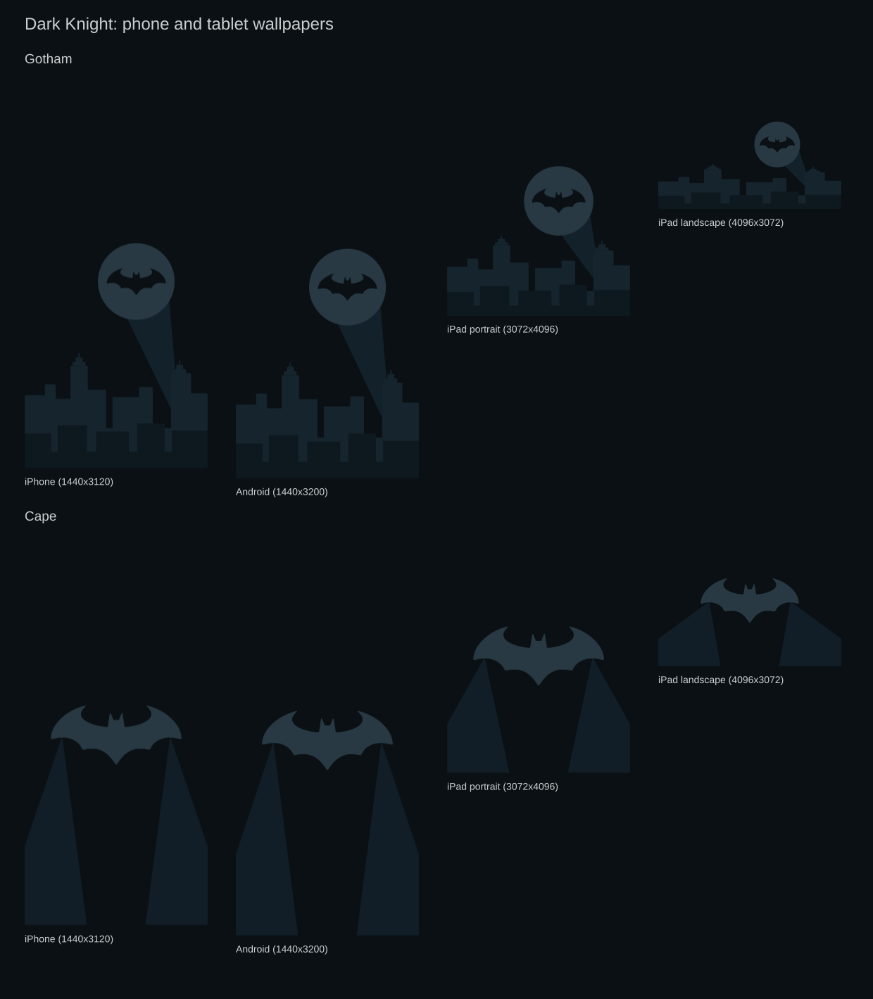

# Phone and tablet wallpapers

Gotham and Cape are recomposed from the theme's flat vector artwork. Each
keeps the upper portion clear for the lock-screen clock. These are general
screen-shape exports; individual devices may crop the image to fit.

| Device shape | Size | Gotham | Cape |
|---|---|---|---|
| iPhone portrait, 19.5:9 | 1440x3120 | [PNG](iphone/gotham.png) | [PNG](iphone/cape.png) |
| Android portrait, 20:9 | 1440x3200 | [PNG](android/gotham.png) | [PNG](android/cape.png) |
| iPad portrait, 3:4 | 3072x4096 | [PNG](ipad/gotham-portrait.png) | [PNG](ipad/cape-portrait.png) |
| iPad landscape, 4:3 | 4096x3072 | [PNG](ipad/gotham-landscape.png) | [PNG](ipad/cape-landscape.png) |

[Download all eight PNGs](https://github.com/itsgg/omarchy-dark-knight-theme/releases/download/mobile-wallpapers-v1/dark-knight-mobile.zip).

The editable SVG exports are in [assets/artwork/mobile](../assets/artwork/mobile/).
Regenerate the PNGs, SVGs, preview and ZIP with `python3 src/mobile.py` from
the repository root. The compositions are defined in that Python file;
regeneration replaces the SVG exports.
